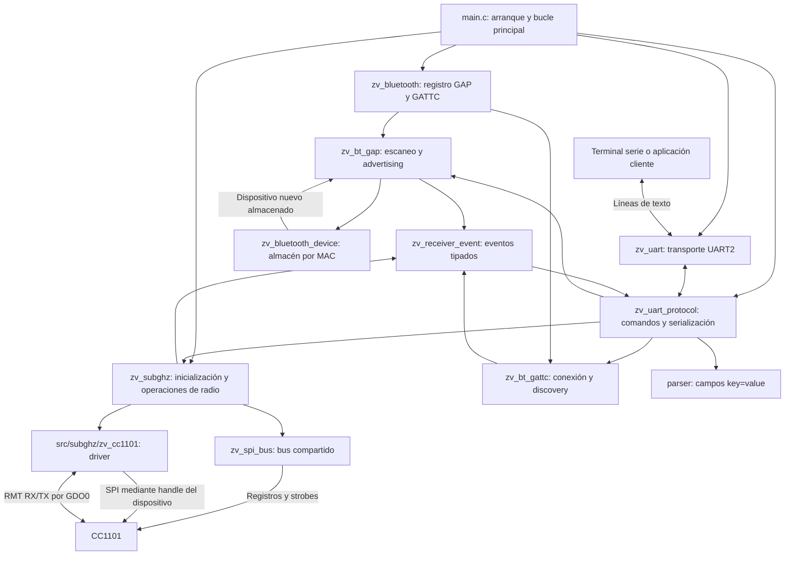

# ZeroVolts Firmware

Firmware en C para ESP32 DevKit, construido con ESP-IDF y PlatformIO. Recibe comandos por UART, ejecuta operaciones BLE o Sub-GHz y devuelve resultados en líneas de texto. Puede controlarse desde una terminal serie o integrarse con cualquier aplicación que implemente el protocolo UART documentado aquí.

**ZeroVolts es un proyecto de aprendizaje en desarrollo continuo.** Su objetivo es aprender y experimentar con firmware en C, BLE, radio Sub-GHz y comunicación entre dispositivos. El código, la arquitectura y el protocolo están en constante mejora y pueden cambiar a medida que se realizan pruebas y se incorporan nuevos conocimientos.

El proyecto incluye escaneo BLE, conexión como cliente GATT, descubrimiento de servicios y características, y captura/transmisión de pulsos OOK mediante un CC1101. La configuración base utiliza 433,92 MHz; el driver ya permite calcular y escribir los registros de frecuencia, con ajustes y validación de radio todavía experimentales.

## Funcionalidades actuales

| Área | Implementación |
|---|---|
| BLE GAP | Escaneo activo de 15 segundos bajo comando; extracción de nombre, MAC, RSSI, fabricante, servicio, apariencia y tipo de dirección. |
| Dispositivos BLE | Almacén estático de hasta 35 dispositivos, deduplicados por MAC. |
| BLE GATT Client | Una conexión activa, solicitud de MTU con máximo local de 500, descubrimiento automático de servicios y enumeración de características con UUID, propiedades y handle. Hasta 20 servicios almacenados. |
| UART | Transporte UART2 a 115200 baud y despacho de comandos separado de los módulos de radio. |
| Sub-GHz RX | Captura RAW con CC1101 y RMT RX, filtro básico de ruido y envío de hasta 256 duraciones en bloques UART. |
| Sub-GHz TX | Recepción de pulsos por bloques con confirmación y reproducción mediante RMT TX, con repeticiones configurables. |
| Control de radio | Reserva compartida entre captura y transmisión para impedir que ambas operaciones usen el CC1101 simultáneamente. |
| Sintonización y RSSI | Cálculo y verificación de registros de frecuencia; lectura de RSSI en dBm mediante API interna, sin comando UART dedicado. |

La configuración y el arranque habilitan **solo BLE**: se libera la memoria de Bluetooth Classic. Las operaciones disponibles se controlan mediante el protocolo UART.

## Arquitectura



### Responsabilidades de cada capa

- **Arranque (`main.c`)**: inicializa NVS, controlador BLE y Bluedroid; registra callbacks; prepara UART y el receptor de eventos; intenta iniciar el CC1101. Después procesa comandos en el bucle principal, con una pausa de 10 ms entre iteraciones.
- **Transporte (`zv_uart.c`)**: configura UART2 y envía líneas terminadas en `\r\n`. El protocolo lee los bytes del driver UART y reconstruye comandos completos.
- **Protocolo (`zv_uart_protocol.c`)**: despacha comandos, valida transferencias Sub-GHz, mantiene el contexto de carga de pulsos y convierte eventos de dominio a respuestas UART.
- **Eventos (`zv_receiver_event.h`)**: define `zv_event_t` y callbacks síncronos para escaneo, conexión, discovery y captura. GAP, GATTC y Sub-GHz notifican al protocolo por este mecanismo. Los datos de dispositivos y capturas son prestados: deben consumirse o copiarse antes de que retorne el callback. El almacén de dispositivos devuelve el dispositivo nuevo a GAP; el protocolo construye `BLE_SCAN:DEVICE` y `BLE_SCAN:DONE` sin dependencias UART en GAP ni en el almacén.
- **BLE (`zv_bluetooth.c`, `zv_bt_gap.c`, `zv_bt_gattc.c`)**: configuración del stack y manejo de callbacks asíncronos de ESP-IDF. El almacén de dispositivos y el formateo de MAC/UUID se mantienen en módulos separados.
- **Sub-GHz (`zv_subghz.c`)**: gestiona el dispositivo SPI, el reset y la verificación del CC1101, la tarea FreeRTOS de captura, el filtro de ruido y la llamada de transmisión. Una reserva protegida por sección crítica coordina el acceso a la radio entre captura y transmisión.
- **Driver (`src/subghz/zv_cc1101.c`)**: acceso a registros, configuración OOK, transiciones de estado, lectura de RSSI y conversión entre pulsos y símbolos RMT. RX y TX comparten GDO0; al preparar un sentido se liberan los recursos RMT del otro.
- **Bus compartido (`zv_spi_bus.c`)**: inicializa SPI y permite adjuntar dispositivos con su propio CS, modo y reloj. Distingue si creó el bus para decidir si puede liberarlo.

### Secuencia de arranque

1. Inicializa NVS y el stack BLE; configura GAP y registra la aplicación GATTC.
2. Inicializa UART2 y conecta los receptores de eventos de GAP, GATTC y Sub-GHz con el protocolo.
3. Envía `READY` por UART.
4. Reinicia el CC1101, lo adjunta al bus SPI y lee `PARTNUM`/`VERSION`. Acepta `PARTNUM=0x00` y versiones `0x14` o `0x04`.
5. Escribe y verifica los registros, solicita RX y comprueba `MARCSTATE`.
6. Envía `SUBGHZ_CHECK_MODULE:OK` o `SUBGHZ_CHECK_MODULE:FAIL` y entra al bucle de comandos. Un fallo del CC1101 no detiene ese bucle.

`READY` indica que UART está disponible; el resultado posterior informa si arrancó el módulo Sub-GHz. El escaneo BLE comienza al recibir `BLE_SCAN`.

### Flujos de radio

**BLE:** `BLE_SCAN` limpia el contenedor e inicia el escaneo. Los dispositivos nuevos producen `BLE_SCAN:DEVICE`; al terminar se envía `BLE_SCAN:DONE`. La conexión se solicita con MAC y tipo de dirección. Tras abrirla se solicita el MTU y, al recibir el evento de configuración de MTU, se inicia automáticamente el discovery. Los eventos de servicios, características y desconexión vuelven por UART.

**Captura Sub-GHz:** el comando crea `subghz_listener_task`. El driver lleva el CC1101 a RX, RMT mide los niveles de GDO0 a 1 MHz y una ISR coloca el evento de recepción en una cola FreeRTOS. La tarea convierte los símbolos en duraciones con signo: positivo para HIGH y negativo para LOW, en microsegundos. Descarta capturas con menos de 20 duraciones o con más de un tercio de pulsos menores de 150 µs y reintenta dentro de la ventana solicitada. Una señal aceptada se serializa en bloques de hasta 32 valores y termina con `SUBGHZ_CAPTURE:DONE`.

**Transmisión Sub-GHz:** `BEGIN` abre una transferencia, `DATA` carga bloques de hasta 16 valores en orden y `END` valida que estén completos antes de llamar a `zv_subghz_transmit()`. El driver empaqueta dos pulsos por símbolo RMT, confirma IDLE, prepara TX, configura `PATABLE`, solicita STX y espera el estado TX. Envía la secuencia una vez por repetición, esperando hasta 2000 ms por envío. Al finalizar o fallar durante la preparación/envío, intenta volver a IDLE y libera canal y encoder TX. La transmisión se ejecuta de forma síncrona desde el handler de `END`.

La captura y la transmisión reservan la radio antes de configurar la frecuencia. Si ya está ocupada, una nueva captura responde `SUBGHZ_CAPTURE:FAIL|reason=busy`; una transmisión falla con `SUBGHZ_SEND:FAIL|id=...|reason=ESP_ERR_INVALID_STATE`. La reserva se libera al terminar la operación.

## Hardware y conexiones

- ESP32 DevKit v1 o compatible con el entorno `esp32dev`.
- Cable USB para compilar, flashear y consultar logs.
- Módulo CC1101 para las funciones Sub-GHz.
- Adaptador USB-UART de lógica de 3,3 V o un dispositivo con UART compatible para enviar comandos.

### UART de comandos

| Señal ESP32 | GPIO | Conexión externa |
|---|---|---|
| UART2 TX | 17 | RX del host |
| UART2 RX | 16 | TX del host |
| GND | GND | Tierra común |

Parámetros: **115200 baud, 8 bits, sin paridad, 1 bit de parada, sin control de flujo**. El monitor USB de PlatformIO permite ver los logs; los comandos de la aplicación se reciben en UART2.

### CC1101

| Señal CC1101 | ESP32 | Uso |
|---|---|---|
| VCC | 3V3 | Alimentación |
| GND | GND | Tierra común |
| CSN | GPIO 5 | Selección del dispositivo |
| SCK | GPIO 14 | Reloj SPI compartido |
| MOSI | GPIO 13 | Datos hacia CC1101 |
| MISO / GDO1 | GPIO 25 | Datos desde CC1101 |
| GDO0 | GPIO 27 | Pulsos RAW mediante RMT RX/TX |
| GDO2 | GPIO 26 | Definido en el cableado; actualmente no se usa en el flujo de captura |

El bus utiliza `SPI3_HOST` (VSPI); el CC1101 se adjunta en modo 0 a 4 MHz. Las líneas compartidas están definidas en `include/zv_spi_bus.h`, CSN en `include/zv_subghz.h` y GDO0/GDO2 en `include/zv_cc1101.h`.

## Compilación y carga

### Entorno de desarrollo actual

Versiones comprobadas en la instalación local el **16 de noviembre de 2026**:

| Componente | Versión o configuración observada |
|---|---|
| Host de desarrollo | Parrot Security 6.4 (lorikeet), ARM64 (`aarch64`) |
| Kernel del host | `6.12.93+rpt-rpi-v8` |
| Python del sistema | `3.11.2` |
| PlatformIO Core | `6.2.0` |
| Plataforma PlatformIO `espressif32` | `6.12.0` |
| Framework ESP-IDF | `5.5.0`, paquete PlatformIO `framework-espidf` `3.50500.0` |
| Toolchain Xtensa | Paquete `toolchain-xtensa-esp-elf` `14.2.0+20241119`; GCC `14.2.0` |
| Entorno y placa | `esp32dev`, target ESP-IDF `esp32` |
| Framework seleccionado | `espidf` |
| Configuración predeterminada | `sdkconfig.default` |
| Monitor serie | `115200` baud |
| Pruebas del parser en el host | GCC `12.2.0` (Debian `12.2.0-14+deb12u1`) |

PlatformIO está instalado en `~/.platformio/penv/bin/pio`. Si `pio` no aparece en el `PATH`, puedes usar esa ruta completa para los comandos de esta sección:

```bash
~/.platformio/penv/bin/pio --version
~/.platformio/penv/bin/pio run -e esp32dev
```

Las versiones se comprobaron en los paquetes locales y ejecutables instalados. `platformio.ini` todavía declara `platform = espressif32` sin fijar versión; una instalación nueva puede resolver otra versión. La plataforma observada corresponde a `espressif32@6.12.0`. Este registro no sustituye una compilación desde cero: el último intento de verificación quedó detenido por los permisos del entorno al crear `~/.platformio/platforms.lock`.

LVGL se utiliza en la Raspberry Pi, dentro del proyecto de interfaz; no es una dependencia de este firmware. Sus versiones, commits y ajustes locales están registrados en el [README de ZeroVolts UI](../zerovolts-ui/README.md#versiones-del-entorno-actual).

### Compilar, cargar y consultar logs

Instala VS Code con la extensión PlatformIO IDE, abre esta carpeta y deja que PlatformIO prepare el toolchain y ESP-IDF. También puedes usar la CLI de PlatformIO desde la raíz del proyecto:

```bash
# Compilar el firmware
pio run -e esp32dev

# Compilar y flashear
pio run -e esp32dev --target upload

# Consultar logs por el puerto USB
pio device monitor -e esp32dev
```

`platformio.ini` selecciona `esp32dev` como entorno predeterminado. `sdkconfig.default` habilita Bluedroid/BLE y deshabilita Classic. El componente de aplicación registra recursivamente los fuentes de `src/` mediante `src/CMakeLists.txt`. La librería experimental de análisis de señales está en `lib/zv_signal_parser/`.

## Protocolo UART

**Lee la [referencia del protocolo UART](protocol/README.md) para entender la comunicación con el ESP32 antes de probar comandos o integrar un cliente.** Allí se explican el formato de mensajes, las órdenes y respuestas, el flujo BLE/Sub-GHz y la integración del header C compartido. INFO y HELP consultan un JSON embebido en el binario y liberan la memoria de interpretación al terminar.

La referencia también incluye las [pruebas desde la consola de la Raspberry Pi](protocol/README.md#pruebas-desde-la-consola-de-la-raspberry-pi), con dos terminales y una explicación de cada parámetro de `stty`, la escucha con `cat` y el envío con `printf` y `tee`.

## Estructura del proyecto

```text
zerovolts_firmware/
├── include/
│   ├── parser.h                  # Parser de campos UART
│   ├── zv_uart*.h                # Transporte y API del protocolo
│   ├── zv_receiver_event.h       # Eventos tipados y callback común
│   ├── zv_bluetooth*.h           # Inicialización BLE y almacén de dispositivos
│   ├── zv_bt_gap.h               # Escaneo y advertising
│   ├── zv_bt_gattc.h             # Conexión y descubrimiento GATT
│   ├── zv_format_utils.h         # MAC y UUID
│   ├── zv_subghz.h               # API de operaciones Sub-GHz
│   ├── zv_cc1101.h               # API del driver y buffer de pulsos
│   └── zv_spi_bus.h              # Bus compartido y pines SPI
├── src/
│   ├── main.c                    # Arranque y bucle de comandos
│   ├── zv_uart.c                 # Transporte UART2
│   ├── zv_uart_protocol.c        # Despacho, eventos y transferencias por bloques
│   ├── parser.c                  # Validación de campos key=value
│   ├── zv_bluetooth.c            # Registro de callbacks y configuración BLE
│   ├── zv_bluetooth_device.c     # Almacén y deduplicación por MAC
│   ├── zv_bt_gap.c               # Callbacks GAP y resultados de escaneo
│   ├── zv_bt_gattc.c             # Callbacks GATTC y eventos de discovery
│   ├── zv_format_utils.c         # Formateo de MAC y UUID
│   ├── zv_subghz.c               # Ciclo de vida del módulo y tarea de captura
│   ├── zv_spi_bus.c              # Gestión del bus SPI
│   ├── subghz/zv_cc1101.c        # Registros, estados y RMT RX/TX
│   └── CMakeLists.txt            # Registro de fuentes de la aplicación
├── protocol/                    # Referencia UART, header compartido y catálogo JSON
├── docs/                        # Tutoriales, notas
├── CMakeLists.txt                # Proyecto ESP-IDF
├── platformio.ini                # Configuración de compilación y carga
├── sdkconfig.default             # Valores predeterminados BLE de ESP-IDF
└── LICENSE                       # Texto de GPL v3
```

## Documentación

Los documentos incluyen tutoriales, experimentos y propuestas; algunos describen pasos futuros o versiones anteriores. Para conocer los comandos y módulos que están implementados, consultar la [referencia del protocolo](protocol/README.md), el código y las secciones anteriores.

| Tema | Documento |
|---|---|
| Fundamentos de Bluetooth y BLE | [00_fundamentos.md](docs/00_fundamentos.md) |
| Escaneo y descubrimiento BLE | [01_ble_Scanner.md](docs/01_ble_Scanner.md) |
| Enumeración de servicios y características GATT | [02_gat_service_enumeration.md](docs/02_gat_service_enumeration.md) |
